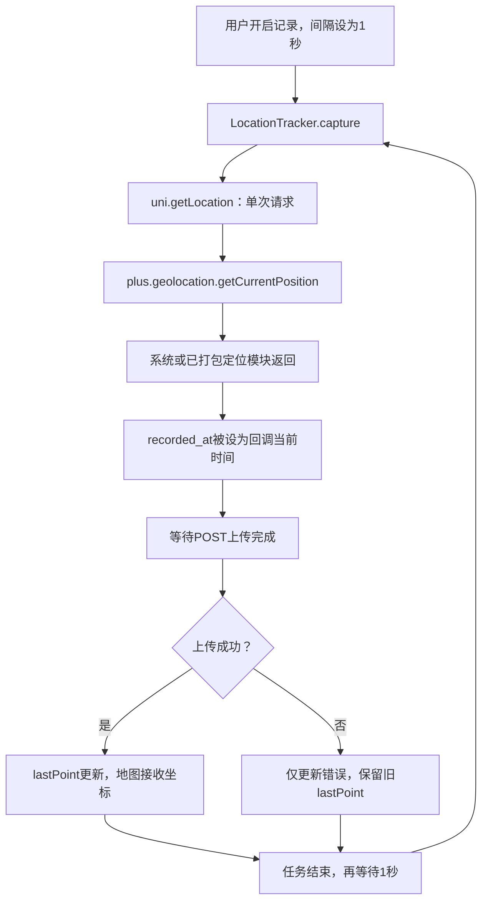
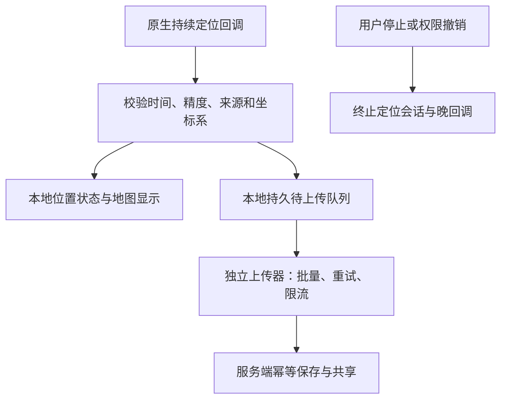

# 春秋GIS安卓端定位非实时：源码、定位来源与荣耀实测问题分析

> 2026-10-17整改状态：APK 1.2.24 已将单次 `uni.getLocation` 串行轮询改为 HTML5+ `watchPosition` 持续订阅，固定请求 system/WGS84、高精度且关闭地理编码；原始 fix 时间可用时直接保留，并拒绝超过新鲜度阈值的缓存点。手机本地地图在收到位置后立即更新；采样和网络写入已经解耦，位置先进入用户专属本地持久队列，正常每 5 分钟最多批量上传一次，失败留待后续补传，不再按 1/2 秒采样频率创建 HTTP/数据库事务。安全问题只在登录初始化和用户主动打开账户权限模块时单次读取，已彻底移出终端状态心跳，并对同类读取增加单飞保护。最近三个有效点保存在本机并用于计算方向；地图“定位”和“追踪”已拆开，实时追踪与回放追踪互斥，切换相机追踪不会停止仍在运行的轨迹回放，追踪相机保持俯视且约离当前位置地面 200 米；回放完整轨迹现在只跨逻辑层与 RenderJS 传输一次，动画帧只传当前点和索引，RenderJS 在本地截取已播放线段。回放线与图标使用记录海拔即时绘制，不再因每帧贴地计算以及追踪相机引发的地形 LOD 变化而反复取消；相机独立限频至约 360ms 一次。开启回放追踪会继续暂停中的回放或在播放完成后从头开始，停止回放则同步关闭回放追踪；单独关闭追踪不会暂停动画。连续30个航向样本足够一致后将行进方向旋转到屏幕上方。后台开关现阶段负责保留/暂停持续订阅并申请后台位置权限；强制结束进程后的长期锁屏记录仍需原生 Android location 前台服务，尚未把权限声明误作该服务已经完成。

日期：2026-10-17。对象：`xiangsongwen00/0-SpringGISNet` 安卓应用及定位后端。重点现象：设置1秒写入，移动较远坐标仍不变，约一分钟才出现最新位置。

## 1. 结论

**当前实现没有建立导航类应用使用的持续位置追踪链路，而是反复单次定位，并把定位、上传和地图更新串在同一条任务中。1秒设置控制的是上次任务完成之后的等待时间，不能保证每秒得到一个新的GNSS位置。**

**用户提出的“多数拿到基站位置，形成不更新表象”值得重点排查。源码已证明：现有链路不能可靠区分新位置、缓存位置、网络粗定位和GNSS位置；但仅凭当前仓库和症状，还不能认定荣耀实测中多数结果就是基站定位。**

更准确的故障模型是两类问题可能叠加：

1. **更新真的慢**：单次定位耗时、上传耗时、失败重试间隔、后台调度或回调异常，使应用很久才处理一个位置。
2. **回调并不慢，但坐标不新或不精确**：反复拿到旧位置、网络粗定位或系统模糊位置。代码又赋予新的记录时间，造成“频繁写入却没有真实移动”的表象。

第一类必须记录每个阶段的耗时；第二类必须取得定位源、原始fix时间及新鲜度。只看数据库写入频率或屏幕上的最后上传时间，无法分辨。

最优先的改造顺序：**先增加可解释诊断，再拆开采集/本地显示/保存上传，随后采用持续定位；如果要锁屏长期记录，再落到原生location前台服务。**

## 2. 审查范围与证据

本次已重新核对仓库最新main，固定提交：

`4ca468c7552ff82ac5a398834f01eed6810d33f7`

该提交中安卓manifest声明版本为1.2.15、versionCode为135、targetSdkVersion为35。实际荣耀安装包是否与此提交、原生基座和权限配置一致，需要设备核验，不能由仓库版本替代。

除应用源码外，还下载检查了项目固定依赖：

`@dcloudio/uni-app-plus@3.0.0-5020420260813003`

检查发布包中的 `dist/uni.runtime.esm.js`，而非仅凭API名称猜测底层行为。发布包SHA-256：

`6c245c25be3a06e75831d060066efe570c3ef56b698cd0c9b3be665d7c66d285`

执行了四项受控时序实验，直接转译并运行当前 `LocationTracker`，用虚拟定位回调、网络请求和时钟验证应用层逻辑。实验不调用真实GNSS，不模拟荣耀系统实现，结果不能用于推定其实际provider。

本次没有连接荣耀手机、读取真实位置轨迹、检查最终APK合并清单或抓取设备logcat，因此不能宣布已经定位到某一条荣耀系统内部故障，也不能承诺改一个参数即可达到导航效果。

## 3. 当前端到端调用链



地图取值来源是页面的 `locationState.lastPoint`。该字段只有上传成功之后才更新；RenderJS收到payload后解析数值，更新固定ID的位置实体。[S1–S5]

服务端没有每分钟触发一次的定位刷新器。`POST /locations/points`收到点后，在同一次请求中更新轨迹段和CurrentLocation并提交数据库。配置的写入间隔还作为轨迹段frequency元数据使用，并不主动驱动手机传感器。[S6]

页面10秒执行的 `syncRemoteState`主要同步授权和终端状态，也不是当前定位的10秒刷新器。

## 4. 已证实的代码问题

### 4.1 1秒不是实际定位周期

`locationTracker.ts`第50–52、55–86行：

```ts
this.timer = setTimeout(() => void this.capture(), this.interval * 1000);
// capture内部：
const point = await /* 单次定位 */;
await uploadLocationPoints(this.accessToken, [point]);
this.emit({ lastPoint: point, ... });
// finally才安排下一次schedule
```

设一次定位耗时L、上传耗时U、配置间隔I，则无其他异常时，相邻请求开始时间间隔约为：

`T = L + U + I + 调度延迟`

例如定位3秒、上传1秒、间隔1秒，下一次请求在约5秒后；不是第1秒就再次请求。这里3秒是例子中的模拟耗时，不是断言每次真实定位必定等待3秒。

同理，当定位回调长时间不返回或UI线程/系统调度出现延迟时，不能靠把I改成1秒解决。

### 4.2 “本地实时位置”被服务器上传结果控制

第80行先 `await uploadLocationPoints`，第81行才更新 `lastPoint`。网络差时，即使系统已经给出新坐标，地图仍显示旧位置；上传失败时，拿到的点也不会进入 `lastPoint`。

网络请求超时配置为15000ms。[S2] 因此，一个已获取的位置可能在等待上传时被压住15秒，失败后地图继续保留更老坐标，之后才重新定位。

当前没有在这条路径中看到可靠的本地持久待上传队列；失败点不会自动成为下一次补传批次。

**手机自身定位显示不应等待服务器确认。** 应在收到合格fix后立即更新本地显示并保存，然后异步上传。远端共享位置可以晚一点到，但不应拖住手机自己的位置。

### 4.3 原始位置时间丢失，回调时间被当作定位时间

第74行：

```ts
recorded_at: new Date().toISOString()
```

它表示JS成功回调被处理的时间，不一定是这条位置被测得的时间。如果底层返还的是旧位置，代码仍会把它包装成“现在的位置”。

后端又按该 `recorded_at`更新CurrentLocation。因此会出现：上传时间不断变化、记录时间不断变化、坐标长时间相同，但现有数据库不能证明位置是否真的新鲜。

相同坐标并不等于旧位置：静止设备的新GNSS fix也可能相同；反过来，相同坐标配上新回调时间也不证明获得新fix。必须分别看原始fix时间和回调接收时间。

### 4.4 固定框架版本进一步丢失时间戳和来源

检查项目固定版本 `uni-app-plus` 发布包：

- 第16507–16522行，`uni.getLocation`调用的是 `plus.geolocation.getCurrentPosition`，为单次请求。
- `isHighAccuracy || altitude`映射到 `enableHighAccuracy`。
- `highAccuracyExpireTime`映射到底层 `timeout`。
- `type`映射到 `coordsType`，当前传入wgs84。
- 该调用没有显式传provider，也没有显式设置maximumAge。
- 第16496–16505行返回给业务层的字段有坐标、altitude、speed、accuracy、address等，不包含原始 `position.timestamp`，也不包含具体传感器provider。[F1]

因此，在当前 `uni.getLocation` 成功回调里简单加一句 `result.timestamp`或`result.provider`，不能保证得到信息；这一固定版本的包装本来就没有透传它们。

HTML5+ Position本身具有timestamp，但具体provider/融合来源不一定通过该公共对象可得。要获得Android Location的fix时间、provider和单调时钟时间，通常需要进一步的原生诊断适配；不能凭空填写。[R2,R6]

### 4.5 highAccuracyExpireTime被错误地与写入间隔绑定

当前使用：

```ts
highAccuracyExpireTime: Math.max(3000, this.interval * 1000)
```

配置1秒时传3000ms；60秒时传60000ms。它控制单次定位的等待/超时参数，与连续更新周期不是一个概念。[F1,R1]

`isHighAccuracy: true`是请求高精度，并不保证一定返回GNSS，也不等于保持GNSS持续工作。即使某一实现遇到超时会返回当前最佳结果，也不能把其结果自动标记为高精度。

不能据此计算“框架必定缓存60秒”，也不能认定“必须每次等满3000ms”。两者都需要运行日志或底层明确契约。尤其当前配置为1秒时，应用传下去的是3000ms，不是60000ms，**源码中没有足以解释固定一分钟周期的硬编码定位间隔**。

### 4.6 回调异常缺少应用级恢复边界

`inFlight`在开始后置true，只有定位Promise和上传完成进入finally才清除。正常定位应成功或失败回调，但如果原生桥/设备异常导致两者都没有触发，当前链路没有独立watchdog、取消与会话隔离来恢复。

这是一项异常恢复缺口，不是已经证实荣耀丢失回调。定位timeout已传递给底层，不应把它描述为“完全没有超时”；问题是业务没有独立防护，也未记录超时是否真正触发。

### 4.7 权限已声明，但没有实现完整后台定位任务

manifest已声明精确/粗略/后台位置、前台服务、location服务权限、通知与WAKE_LOCK，不能建议你只重复添加这些声明。[S3]

但在业务源码及唯一自有UTS模块中，没有找到持续定位服务、`requestLocationUpdates`、`startForeground`、定位服务通知或原生采集持久化。现有UTS模块用于Keystore。

`App.vue`的onHide/onShow只打印日志，记录器由页面对象持有，仍依赖JS定时与回调。仅声明WAKE_LOCK也不等于已经申请和正确释放了唤醒锁；更不等于JS在锁屏后保证运行。[S3,S7]

最终APK可能包含DCloud运行时服务，但不能把框架内任意Service的存在视为项目已经实现了独立、持续的location前台服务。需要检查实际合并清单和运行中的服务注册。

## 5. 专项判断：是不是拿到了基站位置

### 5.1 必须区分五种“位置不动”

| 情况 | 为什么能形成不动表象 | 如何辨别 |
|---|---|---|
| 旧fix/缓存 | 反复返回同一个历史测量 | 原始fix时间不推进，fixAge增长；不能只看JS回调时间 |
| 基站粗定位 | 较大区域内估计位置变化小，可能直到网络观测变化才跳转 | 需要定位源/SDK类型；粗accuracy只提供线索 |
| Wi‑Fi/融合网络定位 | 结果受扫描、热点数据库和融合策略影响，不一定随每步移动改变 | provider/SDK locationType、原始时间与精度、网络状态对照 |
| 系统模糊位置授权 | 系统可提供被粗化的位置 | 检查本应用实际FINE/COARSE授权，不能沿用导航App的权限状态 |
| GNSS正常但前端没有更新 | 上传等待/失败、桥接、渲染或相机未跟随 | 比较原始fix、UI lastPoint、RenderJS实体和地图画面 |

基站定位返回的是估计位置，不一定是基站物理坐标。`provider=network`通常也不能进一步断言“纯基站”，可能混合Wi‑Fi和移动网络；`fused`更不表示单一传感器。accuracy较差也可能来自遮挡和多径下的GNSS。

### 5.2 当前哪些代码支持这个怀疑

支持“无法排除旧位置或网络粗定位”的证据：

- 没有保存实际底层provider或SDK定位类型。
- 没有保存原始fix时间和fixAge。
- 没有结合年龄、精度和运动状态给位置分级。
- 只要定位回调成功，低精度位置也被接受并上传；accuracy虽被保留，但没有准入或降级显示策略。
- framework调用没有显式选择provider，最终取决于实际打包的模块及设备系统实现。

**已证实的是“来源与新鲜度处理不足”，没有证实“代码主动优先选择基站”。**

### 5.3 WGS84不是“纯卫星定位”开关

WGS84首先是坐标表达/参考体系。API参数传wgs84，不足以证明结果一定来自GNSS；网络或融合结果同样可以表达为WGS84。

此项目manifest的Geolocation和sdkConfigs为空对象，未看到明确配置高德/腾讯移动定位SDK；据此更应优先核对系统定位和最终基座，而不是把服务端高德Key当成移动端已经接入融合定位。DCloud官方也说明系统定位在不同Android设备上存在适配差异。[S3,R3]

原生Android GNSS并不是必须依赖Google Play服务才能工作。某些融合定位方案依赖GMS，但这不能推出“荣耀没有GMS，所以GPS一定不能实时”；无GMS设备仍可使用系统GNSS或适配当地设备的定位SDK。[R4]

### 5.4 “位置解析”在当前工程中分别是什么

| 环节 | 本次结果 |
|---|---|
| JS经纬度读取 | 直接取result.longitude/latitude，没有整数化、明显经纬度互换或按分钟节流 |
| uni框架坐标处理 | 当请求坐标系与底层坐标系不同，会执行转换；当前没有证据证明坐标系标签错误 |
| Vue→RenderJS JSON | 数值被序列化和解析，未见将坐标替换为基站/地址中心的逻辑 |
| 地图实体更新 | 直接更新位置，贴地主要影响高度；不负责决定GNSS或网络来源 |
| 服务端IP定位 `/locations/ip` | 有独立接口，取IP地理矩形中心，但未发现安卓当前采集链调用它 |
| 服务端反向解析 `/locations/place` | 根据已有坐标查地名，返回输入坐标，未见用地址中心覆盖当前位置 |
| Android“定位”按钮 | 飞到lastPayload已有坐标，不会强制发起一次新的硬件定位 |

因此，**目前未发现“反地理编码把实时坐标解析成基站/地址中心”这一业务代码错误**。更需要关注的是底层位置到底怎么来、是否新鲜，以及业务丢掉这些信息后的误判。[S4–S6]

坐标系混用通常造成位置偏移；单靠偏移不足以解释约一分钟不变。若后续接入返回GCJ‑02的SDK，必须显式转换并标记，不能直接当WGS84送进引擎。

## 6. 约一分钟更新的原因分级

| 原因 | 证据等级 | 对本现象的解释力 |
|---|---|---|
| 单次定位+上传+等待串行 | 代码确认、实验复现 | 确定造成实际周期大于1秒，但不能单独推出60秒 |
| 上传成功后才显示 | 代码确认、实验复现 | 移动网络差、接口失败时会显著放大视觉滞后 |
| 旧fix/粗定位被当成新位置 | 处理缺口已确认；荣耀实际来源待测 | 特别符合“时间在更新、移动很远坐标仍相同” |
| 仅获模糊位置授权 | 平台允许该行为；实际授权未知 | 与导航App表现不同并不矛盾，两者授权独立 |
| 系统定位模块/基座适配 | 框架与打包配置线索；设备待测 | 同样参数在不同机型可能行为不同 |
| 后台/锁屏限制 | 缺原生持续链路已确认；触发状态未知 | 若仅锁屏/切后台异常，优先级很高 |
| 原生回调异常/JS调度停顿 | 防护缺口已确认；实际待测 | 可造成长暂停和随后跳点 |
| 地图桥接/渲染阻塞 | 需对比lastPoint与实体 | 若文本坐标已更新而图标没动，才优先查这里 |
| 后端固定60秒合并/延迟更新 | 当前实现未发现 | 不能把配置frequency或10秒状态同步误认为根因 |
| 服务端IP/地址解析覆盖安卓点 | 当前调用链未发现 | 目前没有源码支持 |

如果手机一直亮屏、应用可见、接口响应很快，仍一分钟不动，则应把**定位源/原始fix年龄/精确权限/单次回调耗时**放到最前，而不是先调整后台保活。

如果切后台或锁屏后才出现，就需要另查原生服务和系统调度。Android官方背景位置限制不是固定“每分钟一次”，不能用60秒现象直接识别该限制。[R7]

## 7. 为什么导航软件通常可以

以下描述的是导航类系统常见架构及官方SDK提供的能力，不代表审查了某款导航App的内部实现。

| 环节 | 当前工程 | 导航类常见做法 |
|---|---|---|
| 位置请求 | JS反复单次getLocation | 长时间订阅位置更新，按移动场景配置 |
| 位置来源 | 黑盒成功回调，缺来源记录 | GNSS与网络/传感器协作，保留质量与状态 |
| 新鲜度 | 以JS回调时间代替 | 按原始fix时间判断新旧，处理缓存与超时 |
| 本地显示 | 等上传成功 | 直接消费本地定位流，不依赖业务服务器写入 |
| 锁屏运行 | JS页面记录器 | 合适的原生location前台服务和用户可见通知 |
| 轨迹连续性 | 逐次点、无本地补传队列 | 原生采集、本地缓存、断点与补传 |
| 视觉效果 | 新坐标到来后更新 | 可以叠加预测、插值、方向平滑与地图匹配 |

Android官方提供持续位置更新接口；高德SDK也提供连续模式、期望间隔、定位模式和缓存控制。它们解决的是位置流的生命周期，而不是让页面不停“重新查一次当前位置”。[R4,R8]

**导航图标流畅不代表每帧都获得新的卫星解。** 定位更新可能约1Hz，画面按更高帧率插值；路网匹配与航位推算可以在短时弱信号中改善显示，但估计值不能伪装成真实采集点写入轨迹。

同一部手机上导航正常，说明设备在那个场景具备可用定位能力；不能证明另一个App拥有相同精确权限、provider、会话、前台服务或缓存策略。

也不建议把“先打开导航，再测试自己App后变好了”视为修复。其他App可能激活或预热系统位置服务；这种变化是诊断线索，应分别测试冷启动和导航预热后的状态，避免污染对照。[R7]

## 8. 四项代码实验结果

实验使用当前LocationTracker代码，模拟固定时延与虚拟时钟，没有修改项目源码。

| 场景 | 输入 | 实际结果 | 证明内容 |
|---|---|---|---|
| 串行周期 | 定位3秒、上传1秒、间隔1秒 | 请求开始于0、5、10秒；首次显示4秒 | 配置1秒不等于1Hz定位 |
| 网络失败 | 定位立即返回，上传15秒后失败 | 已有位置回调，但lastPoint更新次数为0 | 本地显示被上传结果阻塞 |
| 桥接无回调 | 不触发成功/失败，推进虚拟时钟120秒 | 仅发起1次定位 | 缺独立watchdog时链路不能自恢复 |
| 旧/粗结果反复返回 | 固定坐标、模拟network及旧timestamp | 每秒得到不同recorded_at，但坐标相同；来源和原时间未保留 | 现有代码可制造“新记录、旧位置”表象 |

第四项中的network是实验输入，不是荣耀实测provider；它证明的是代码如何处理这类输入。第三项刻意模拟底层违约，不代表正常设备一定发生。

## 9. 应如何整改

### 9.1 第一步：增加定位诊断，而非继续调1秒

每条原始回调记录：

| 字段 | 意义 |
|---|---|
| sessionId / sequence | 区分采集会话和顺序，防停止后的晚回调污染 |
| requestStartedAt / callbackAt | 单次定位究竟等待多久 |
| fixTimeUtc | 底层位置测得时间；取不到时明确unknown |
| fixElapsedRealtimeNanos | Android原生可提供的单调时钟时间，用于计算年龄 |
| fixAgeMs | 回调收到时该fix已多旧，避免手机改时钟造成误判 |
| provider / locationType | 实际可获得的来源标签，区分provider与内部融合类型 |
| coordinatesType | WGS84/GCJ‑02等，禁止隐式混用 |
| accuracy / speed / bearing | 质量与运动状态；保留缺失状态，不把缺失当0 |
| permissionFine / permissionCoarse | 本应用真正获得的精确/粗略授权 |
| appVisible / screenOn / serviceActive | 是否前台、是否锁屏、定位前台服务是否真的运行 |
| uploadStartedAt / uploadFinishedAt | 网络耗时及失败，与采集分开 |
| uiReceivedAt / renderAppliedAt | 坐标何时进入UI与渲染实体 |

GNSS卫星参与数、定位状态和信号质量可作为原生专项诊断，非每条业务记录必需；不能仅凭“可见卫星多”就判断已获得有效位置解。

当前uni包装不提供原始时间/来源时，先通过可控的HTML5+ Position诊断时间戳；更完整的provider/单调时钟信息通过原生适配获取，并核验实际供应者对时间字段的语义。不要编造fixTime。

UI分别显示：最后一次**新fix**时间、位置年龄、精度等级、最后上传时间、待上传点数。`recorded_at`旧数据目前是回调时间，后续迁移应明确其历史语义，不能直接当成真实fixTime做精度统计。

### 9.2 第二步：拆开采集、显示、保存、上传

建议流程：



停止时应取消订阅、使当前session失效，并阻止晚回调进入显示和上传链路。

- 手机地图立即消费本地位置，不await上传。
- 原始合格点先持久化，网络失败不丢点；按sessionId+sequence或稳定pointId补传去重。
- 上传间隔和采集间隔分开配置。1秒采集可每几秒上传一批；远端实时模式需要更低传输延迟时再调策略。
- 低质量位置可作为降级参考点显示，但不要自动视为高质量轨迹点。过滤必须保留原因，防止“过滤后没点”又被误认为定位没更新。
- 后台记录不依赖地图是否打开；地图停止渲染不应停止采集服务。

### 9.3 第三步：前台连续定位与长期后台定位分阶段完成

**阶段A，前台验证：** 使用HTML5+ watchPosition或原生连续接口建立一个定位会话，停止时明确clearWatch/取消订阅。HTML5+的maximumAge在其watchPosition文档中用于更新间隔，不能直接套用浏览器W3C同名选项的缓存语义。持续订阅也只是期望更新，不是保证每秒必有新fix。[R2,R5]

**阶段B，长期后台：** 用UTS/Kotlin等实现location前台服务，订阅系统GNSS/可用融合provider，建立本地持久队列、通知停止入口、权限撤销和进程恢复处理。服务应该在用户可见、主动开启记录时按平台规则启动。当前target35要核对实际合并清单的服务类型、权限与运行时限制。[R9]

后台位置权限、location前台服务和通知是不同机制；不是所有场景都必须先取得“始终允许”才能在前台启动正确的服务，也不是拿到“始终允许”就能绕过后台限制。应按启动时机、目标Android版本和实际功能逐项实现。

### 9.4 定位供应者选择

有两条合理路线：

1. **系统原生持续定位**：适合坚持WGS84、希望直接诊断GNSS来源和fix时间的轨迹产品。可同时观察GNSS和系统网络位置，再按年龄与质量选择；不应简单“最后到的覆盖全部”，否则晚到的粗定位会覆盖新鲜GNSS。
2. **专业移动定位SDK**：适合需要更多机型适配、网络融合与完整诊断类型的产品。应按实际设备、坐标系和业务验证；接入高德/腾讯等移动定位模块，不等于要更换春秋GIS渲染引擎。

现阶段不要把“换一个SDK”当成唯一答案。无论底层选择哪条路线，上传阻塞显示、时间语义、持久队列和后台服务都仍然要解决。

地图底图Key、服务端Web地名解析Key、移动定位SDK配置是不同用途。最终包名/签名/基座也必须与所选方案一致，热更新JS不能补出没有打包的原生模块。

### 9.5 新鲜度与精度策略

建议建立明确状态：`searching`、`fresh-precise`、`fresh-approximate`、`stale`、`permission-limited`、`provider-error`。不要把所有成功回调统一归为“当前实时位置”。

可从下列工程初值开始实测调整，不作为统一质量保证：

- 前台移动时，以约1秒为期望采集间隔。
- fixAge超过约3–5秒先标延迟，超过约10秒标过期；具体阈值按步行/车辆速度调整。
- accuracy在10–30米范围可作为普通手机步行显示的一个参考等级；100米以上应明显提示粗定位。城市峡谷、室内等环境不能靠统一阈值强行产出“精确轨迹”。
- 禁止仅凭坐标相同丢点：静止可以有新fix。去重优先使用原始fix身份/时间，并结合轨迹压缩策略。
- provider与accuracy共同解释，不将network一概当垃圾，不将gps一概当高质量。
- 用位置估计误差和运动约束识别跳点；原始点和处理结果分开保留，避免滤波掩盖故障。

## 10. 荣耀手机的实测诊断方案

### 10.1 先验证最小前台场景

选择开阔室外路线，手机亮屏，应用始终可见，关闭省电模式；检查本App精确位置已授权。记录机型、MagicOS/Android版本、APK versionCode和构建SHA。先记录搜索和首次有效fix，再开始移动测试。

首轮暂不运行其他导航App，避免系统位置服务被预热。分别进行：静止、步行数百米、停留后继续；采样日志按时间对齐。

只要本地坐标尚未得到证实，就不应该用底图是否加载或3D帧率判断定位成功。

### 10.2 对照矩阵

| 测试 | 设置 | 目的 |
|---|---|---|
| A | 前台、精确权限、正常网络、只显示坐标文本 | 建立定位回调基线 |
| B | 同A，地图加入 | 判断RenderJS/渲染负载是否放大延迟 |
| C | 同A，定位成功后禁用上传或人为模拟慢上传 | 验证当前网络与显示耦合；整改后两者应独立 |
| D | 前台，系统单次与持续订阅分别跑 | 判断单次策略是否影响新fix连续性 |
| E | 原生诊断，分别观察GNSS与network | 判断固定坐标究竟来自哪个provider和时间 |
| F | 切后台，再锁屏；记录服务/通知状态 | 判断后台降频和JS/原生运行状态 |
| G | 手动允许后台活动后重复F | 量化厂商策略影响，菜单名称按当前MagicOS为准 |
| H | 独立运行导航，再做有导航预热对照 | 验证设备可用性和预热影响，不将其当产品依赖 |

C应在诊断构建做，不要通过关闭系统网络同时破坏定位辅助条件来混淆变量。E若禁用网络/只用GNSS，也应说明辅助数据和环境已变化，首次定位可能更慢。

荣耀官方后台保护资料提示部分轨迹异常与后台管理有关，但该资料面向荣耀运动健康。它能支持“需要检查厂商后台限制”的方向，不能证明第三方App当前就是同一个问题。尤其前台异常应优先查位置源与链路。[R10]

### 10.3 一眼判断故障在哪一层

| 日志现象 | 优先结论 |
|---|---|
| requestStartedAt本身很久才出现一次 | 串行任务、后台定时器或调度异常 |
| 请求频繁，但定位回调长时间不来 | 底层provider/信号/精确权限/原生桥问题 |
| callbackAt推进，原始fixTime不推进 | 旧fix重复交付；查缓存和provider |
| fixTime推进，accuracy很粗，位置按区域跳变 | 网络粗定位或模糊权限可疑；继续核验来源 |
| 原始GNSS点持续变化，但lastPoint不变 | 应用上传门控或状态逻辑 |
| lastPoint变化，RenderJS实体坐标不变 | 桥接/实体更新/异常捕获 |
| 实体变化但镜头没跟随 | 当前没有自动跟随模式，不等于定位没更新 |
| 屏幕时间变新但坐标不变，没有fixTime | 当前数据不足，不能判定是静止、缓存还是基站 |

### 10.4 ADB只读诊断

设备连接开发电脑后，先用实际包名替换占位符，不要把uni appid当作Android包名：

```bat
adb shell dumpsys location
adb shell dumpsys package YOUR_ANDROID_PACKAGE
adb shell cmd appops get YOUR_ANDROID_PACKAGE
adb shell dumpsys activity services YOUR_ANDROID_PACKAGE
adb shell dumpsys deviceidle
```

重点核查应用实际FINE/COARSE/BACKGROUND授权、活跃位置请求的provider/interval、最后位置时间，以及location服务是否运行。输出格式因Android/厂商不同而变化，不应用固定文本模板硬判。日志与dumpsys可能含精确位置，仅在本机用于诊断即可。

本次未执行上述设备命令，也未读取用户的私人轨迹。

## 11. 后端与数据模型应同步调整

当前点结构缺少fix来源与年龄，schemas还设置了extra=forbid。若客户端直接新增字段上传，服务端可能返回422；必须协调修改前后端协议。[S2,S6]

建议新增：

- `point_id/session_id/sequence`：离线重试幂等。
- `fix_time`：确实来自定位解的时间，取不到明确null/unknown。
- `callback_at`与`received_at`：区分客户端接收和服务端入库。
- `provider/positioning_type/coords_type`：不要用笼统的android-location代替实际来源。
- `fix_age_ms/quality/status`：保留质量和降级原因。

原始单调时钟适合设备内计算年龄，不应直接跨设备排序；手机重启后也不能跨boot直接相减。服务端按真实时间与会话顺序处理迟到点，避免离线补传旧点覆盖最新点。[R6]

现有每次上传都会重建轨迹段points数组，最多约1000点后分段。这不是固定一分钟刷新逻辑，但记录量增加和数据库变慢时可能增加U，进一步拖慢当前串行采集；需测接口p95而不是直接归因数据库。

## 12. 验收标准与最终判断

整改应以这些结果验收：

1. 开阔室外前台，能提供真实fix时间、年龄、来源或明确unknown，不能再把回调时间当作新定位证据。
2. 目标设备连续移动时，统计新鲜fix的间隔分布，而非仅统计上传请求数量；以期望1Hz为目标，记录实际p50/p95与长缺口。
3. 网络延迟、失败或断网不阻止本地位置更新；已采集点保存在本地，恢复后按身份去重补传。
4. 锁屏记录由经过验证的原生定位生命周期承担；记录权限/服务/通知状态和实际采集缺口。
5. 粗定位、过期位置和位置搜索状态在UI可区分；估计/插值仅改善显示，不伪装成实测轨迹。
6. 停止后取消订阅并隔离晚回调；重新开始不混入上个会话结果。

**最终判断：当前并不是手机做不到实时，而是应用尚未实现可靠的实时定位系统。源码已经明确证明节拍、上传耦合、时间语义和后台生命周期存在问题；用户怀疑的基站/网络粗定位或缓存路径仍需日志确认，但现有实现确实缺少识别与正确处理它们的能力。**

若实际现象是“坐标每分钟跳一下，但界面上传时间每几秒在变”，定位来源/新鲜度应列为第一排查项；若时间和坐标都一分钟才变化，就先测单次定位、上传和后台调度各花了多久。这两个现象的处理顺序不同。

## 附录：固定源码与官方依据

### 项目源码

- S1：[locationTracker.ts](https://github.com/xiangsongwen00/0-SpringGISNet/blob/4ca468c7552ff82ac5a398834f01eed6810d33f7/0-auth-Apk/src/services/locationTracker.ts)：第50–86行，采集、上传、状态更新与调度。
- S2：[客户端API](https://github.com/xiangsongwen00/0-SpringGISNet/blob/4ca468c7552ff82ac5a398834f01eed6810d33f7/0-auth-Apk/src/services/api.ts)、[APK配置](https://github.com/xiangsongwen00/0-SpringGISNet/blob/4ca468c7552ff82ac5a398834f01eed6810d33f7/0-auth-Apk/config/apk.env.json)：点结构与15000ms网络超时。
- S3：[manifest.json](https://github.com/xiangsongwen00/0-SpringGISNet/blob/4ca468c7552ff82ac5a398834f01eed6810d33f7/0-auth-Apk/src/manifest.json)：版本、模块、权限、target35及SDK配置。
- S4：[页面](https://github.com/xiangsongwen00/0-SpringGISNet/blob/4ca468c7552ff82ac5a398834f01eed6810d33f7/0-auth-Apk/src/pages/index/index.vue)、[地图组件](https://github.com/xiangsongwen00/0-SpringGISNet/blob/4ca468c7552ff82ac5a398834f01eed6810d33f7/0-auth-Apk/src/components/SpringGisMap.vue)：lastPoint与payload链路。
- S5：[RenderJS地图](https://github.com/xiangsongwen00/0-SpringGISNet/blob/4ca468c7552ff82ac5a398834f01eed6810d33f7/0-auth-Apk/src/renderjs/springGisMap.js)：updateLocation、applyLocation与定位按钮。
- S6：[后端locations.py](https://github.com/xiangsongwen00/0-SpringGISNet/blob/4ca468c7552ff82ac5a398834f01eed6810d33f7/0-pythonServer/app/api/v1/locations.py)、[schemas.py](https://github.com/xiangsongwen00/0-SpringGISNet/blob/4ca468c7552ff82ac5a398834f01eed6810d33f7/0-pythonServer/app/schemas.py)：接收、CurrentLocation更新、IP/地名接口及字段限制。
- S7：[App.vue](https://github.com/xiangsongwen00/0-SpringGISNet/blob/4ca468c7552ff82ac5a398834f01eed6810d33f7/0-auth-Apk/src/App.vue)、[Keystore插件](https://github.com/xiangsongwen00/0-SpringGISNet/tree/4ca468c7552ff82ac5a398834f01eed6810d33f7/0-auth-Apk/src/uni_modules/springgis-keystore)、[APK打包指南](https://github.com/xiangsongwen00/0-SpringGISNet/blob/4ca468c7552ff82ac5a398834f01eed6810d33f7/0-auth-Apk/APK打包教程.md)：生命周期与既有后台限制说明。
- F1：[固定版本uni-app-plus发布文件](https://unpkg.com/@dcloudio/uni-app-plus@3.0.0-5020420260813003/dist/uni.runtime.esm.js)：第16481–16522行；本次实际读取对应npm发布包。

### 官方技术资料

- R1：[uni.getLocation](https://uniapp.dcloud.net.cn/api/location/location.html)：精度、等待参数、altitude开销和平台差异。注意cacheTimeout在该文档列为特定小程序参数，不是当前Android App的通用“禁缓存”开关。
- R2：[HTML5+ geolocation](https://www.html5plus.org/doc/zh_cn/geolocation.html)：单次/监听、Position.timestamp、provider与coordsType、watchPosition选项。
- R3：[DCloud定位模块](https://uniapp.dcloud.net.cn/tutorial/app-geolocation.html)：系统定位和第三方模块，以及设备适配差异。
- R4：[Android持续位置更新](https://developer.android.com/develop/sensors-and-location/location/request-updates)：位置订阅与回调模式。
- R5：[LocationRequest.Builder](https://developers.google.com/android/reference/com/google/android/gms/location/LocationRequest.Builder)：更新间隔是期望值，可因系统限制而变慢；Google Play services方案不代表所有国产机均可直接使用。
- R6：[Android Location](https://developer.android.com/reference/android/location/Location)：位置时间与单调时钟，用于判断年龄和顺序。
- R7：[Android后台位置限制](https://developer.android.com/about/versions/oreo/background-location-limits)：后台定位受限，与请求频率不是同一概念。
- R8：[高德获取定位数据](https://lbs.amap.com/api/android-location-sdk/guide/android-location/getlocation)：定位模式、连续更新和缓存；作为可选方案参照，不代表项目当前已接入。
- R9：[Android前台服务类型](https://developer.android.com/develop/background-work/services/fgs/service-types)、[运行时位置授权](https://developer.android.com/develop/sensors-and-location/location/permissions/runtime)：location服务及精确/模糊权限。
- R10：[荣耀后台保护说明](https://www.honor.com/cn/support/content/zh-cn15877113/)：厂商后台管理排查参考，具体菜单与当前机型系统为准。

